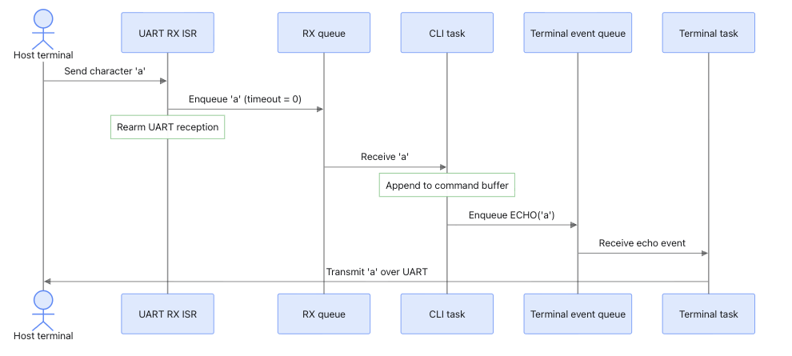

# CMSIS-RTOS2 Message Queues

*Using FreeRTOS through the CMSIS-RTOS2 API*

## Learning goals

By the end of this lab, you should be able to:

- Trace the order of messages through a queue.
- Create a queue and send and receive values.
- Explain what happens when a queue is full or empty.
- Design communication between two tasks.

## The communication problem

A sensor task produces these readings:

**21, 22, 23**

A display task runs less frequently.

**Discussion:** If both tasks use one shared variable, which readings might the display miss?

> **Notes:** Original motivating example. If each new reading overwrites the same variable before the display reads it, the display might see only 23. Sometimes that is acceptable. Ask whether the application needs every reading or only the latest reading.

**Discussion:**  What about global variables?

> **Notes:** Global variables are considered problematic because any code that can access them may depend on or change them, making a program harder to understand as it grows.
> - Hidden dependencies: a function’s behaviour depends on state that is > not visible in its arguments.
> - Unexpected changes: one part of the program can modify a value that another part assumes is stable.
> - Difficult debugging: when a value is wrong, you may need to inspect every place that writes it.
> - Difficult testing: tests must set up and reset global state, or one test can affect another.
> - Poor reuse: code tied to one global sensor value is harder to reuse for several sensors.
>- Concurrency problems: RTOS tasks can access the same data at overlapping times, requiring synchronization.


## A queue stores waiting messages

- A producer sends an item.
- The queue holds a copy until a consumer receives it.
- Receiving removes the item.
- All examples use message priority `0`, giving **FIFO** order.

| Operation | Queue contents, oldest first |
| --- | --- |
| Send 21, then 22 | 21, 22 |
| Receive one item | 22 |


## Queue capacity and item size

```c
osMessageQueueId_t readings;

readings = osMessageQueueNew(4, sizeof(int32_t), NULL);
if (readings == NULL) {
    /* Handle queue creation failure. Do not start users of this queue. */
}
```
Parameters
- Capacity: **4 items**.
- Item size: **one `int32_t`**.
- NULL - default attributes.

> **Notes:** Include stdint.h and cmsis_os2.h. Initialize the kernel with osKernelInitialize(), create the queue and threads, then call osKernelStart(). Check creation results before starting users of the queue. In generated projects, use the existing initialization sequence.

> Source: https://arm-software.github.io/CMSIS_6/main/RTOS2/group__CMSIS__RTOS__KernelCtrl.html
> Source: https://arm-software.github.io/CMSIS_6/main/RTOS2/group__CMSIS__RTOS__Message.html


## Timeouts use kernel ticks

```c
/* Convert short, bounded classroom delays, rounding up. */
static uint32_t ms_to_ticks(uint32_t ms) {
    return (uint32_t)(((uint64_t)ms * osKernelGetTickFreq()
                       + 999U) / 1000U);
}
```

**100 ticks equals 100 ms only when the tick frequency is 1000 Hz.**

> **Notes:** This helper is defined once and used by later snippets. Call it after kernel initialization. Restrict inputs so the result fits a finite timeout below osWaitForever. Rounding up avoids converting a positive short interval to zero. Tick phase and scheduling affect observed wall-clock delay. This is application code, not a standard CMSIS conversion macro.
> Source: https://arm-software.github.io/CMSIS_6/main/RTOS2/group__CMSIS__RTOS__KernelCtrl.html

## Sending a value

```c
int32_t value = 21;

osStatus_t status = osMessageQueuePut(
    readings, &value, 0U, ms_to_ticks(100));
if (status != osOK) {
    /* Handle timeout or another reported error. */
}
```

| Argument | Meaning |
| --- | --- |
| `readings` | Destination queue |
| `&value` | Address of the item to copy |
| `0U` | Message priority used throughout this lesson (ignored in freeRTOS)|
| `ms_to_ticks(100)` | Maximum blocking time in kernel ticks |

> **Notes:** A send can return immediately when space is available. CMSIS defines message priorities, but the CMSIS-FreeRTOS adapter ignores msg_prio. Use zero consistently and do not rely on priority sorting with this backend.
> Source: https://arm-software.github.io/CMSIS-FreeRTOS/latest/page_technical_data.html

## Receiving a value

```c
int32_t received;

if (osMessageQueueGet(readings, &received, NULL,
                      ms_to_ticks(100)) == osOK) {
    /* Use received here. */
}
```
| Argument | Meaning |
| --- | --- |
| `readings` | Destination queue |
| `&received` | Address of the item to copy into |
| `0U` | Message priority used throughout this lesson (ignored in freeRTOS)|
| `ms_to_ticks(100)` | Maximum blocking time in kernel ticks |

when timeout is 0, the function returns instantly (i.e. try semantics).
when timeout is set to **osWaitForever** the function will wait for an infinite time until the message is retrieved. (i.e. wait semantics).
all other values specify a time in kernel ticks for a timeout (i.e. timed-wait semantics).

> **Notes:** Source: https://arm-software.github.io/CMSIS_6/main/RTOS2/group__CMSIS__RTOS__Message.html

## Full and empty queues

| Situation | Wait time is zero | Wait time is positive |
| --- | --- | --- |
| Send to a full queue | `osErrorResource` | Waits for space, then `osErrorTimeout` if still full |
| Receive from an empty queue | `osErrorResource` | Waits for data, then `osErrorTimeout` if still empty |

Successful puts and gets return `osOK`. A blocked thread waits without consuming CPU time.

**Discussion:** Why might blocking be better than repeatedly checking an empty queue?

> **Notes:** Answer: repeated polling can waste CPU time. A blocked task allows other ready tasks to run. Once unblocked, scheduling determines when it actually executes.
> Source: https://arm-software.github.io/CMSIS-FreeRTOS/latest/page_technical_data.html


## Copying values and pointers

For a queue created with `sizeof(int32_t)`:

```c
int32_t value = 21;
osMessageQueuePut(readings, &value, 0U, 0U);  // Assume success for this example.
value = 99;
```

The queued value remains **21**.

A queue of pointers copies the **address**. The application must keep the pointed-to data valid until the receiver finishes using it.


## Producer and consumer speeds

Suppose, on average:

- A producer generates **10 messages per second**.
- A consumer handles **6 messages per second**.

**Question:** What happens to a finite queue over time?

A larger queue can absorb a temporary burst. Sustained overload still requires a decision about waiting, dropping messages, or changing the processing rate.

> **Notes:** Original reasoning exercise. Before the queue fills, backlog grows by about 4 messages per second under these simplified assumptions. Once full, the sender's blocking and failure policy determines what happens. Do not imply a larger queue permanently fixes the throughput mismatch.

## Previous lab: CLI part 2 architecture

| Component | Responsibility | Suggested starting priority |
|---|---|---|
| UART receive callback | Queue the received character and rearm reception | Interrupt priority compatible with RTOS calls |
| CLI task | Build command lines, handle backspace, validate and dispatch commands | `osPriorityNormal` |
| Terminal task | Own UART transmission, echo text, and render ANSI screen updates | `osPriorityNormal` |
| LED task, if included | Apply blink commands and maintain LED timing | `osPriorityAboveNormal` |

### Character send sequence digram


## Lab design decisions
Before coding, agree on:

- The data type carried by each queue.
- Queue capacities and send-failure behaviour.
- An allowed range for the delay command.
- How each task keeps doing its work while checking messages.

**Test cases:** a valid command, invalid input, rapid commands, and a full status queue.

## Common mistakes

| Mistake | Better practice |
| --- | --- |
| Incorrect item size | Use `sizeof` with the actual message type |
| Ignored return value | Handle failed sends and receives |
| Milliseconds passed as ticks | Convert using `osKernelGetTickFreq()` |
| Pointer to expired data | Define data lifetime and ownership |
| Blocking inside an interrupt | Put/Get must use timeout `0` |
